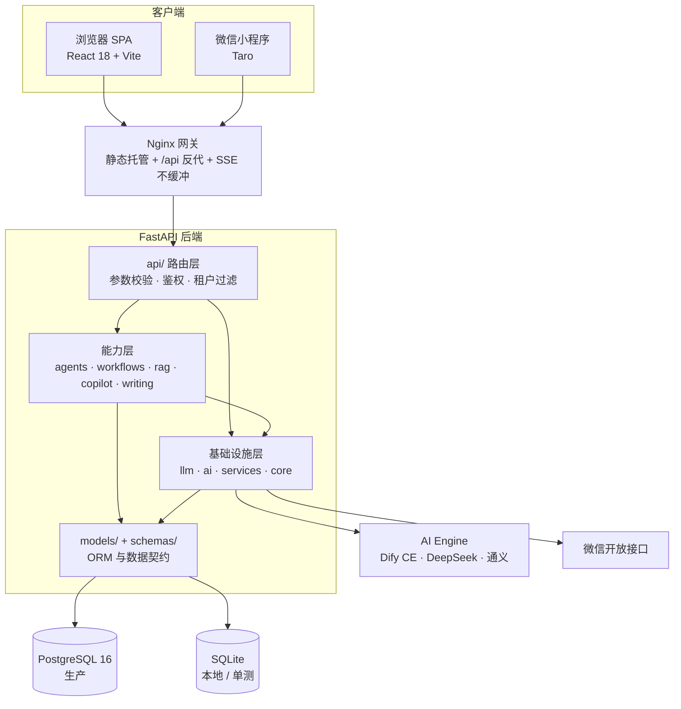
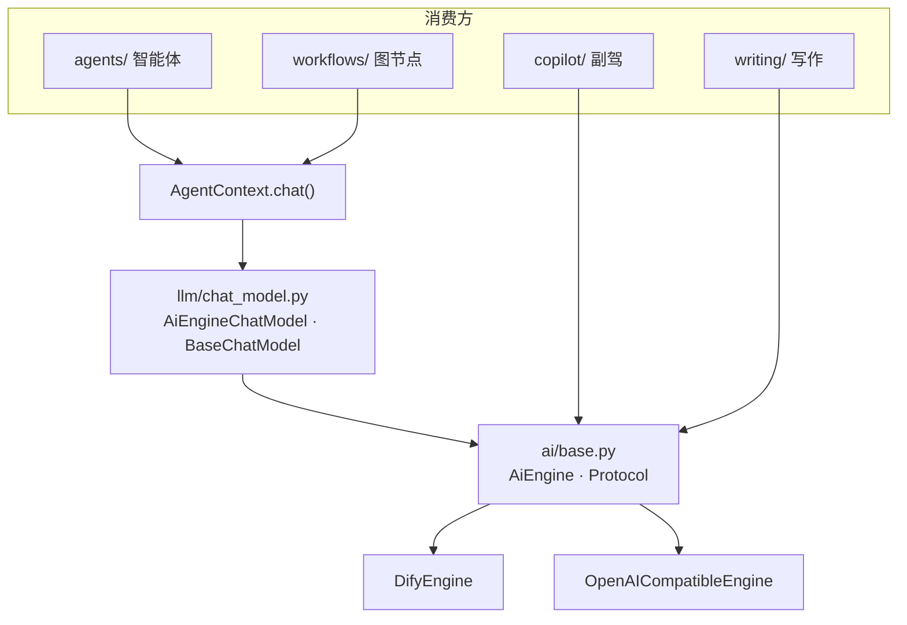
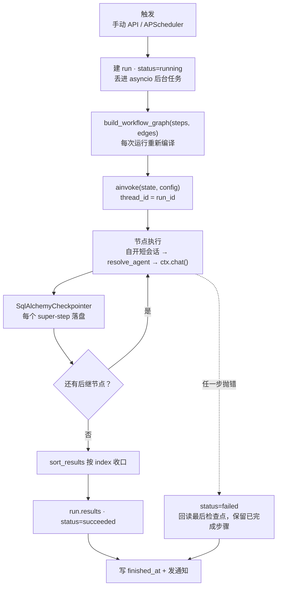
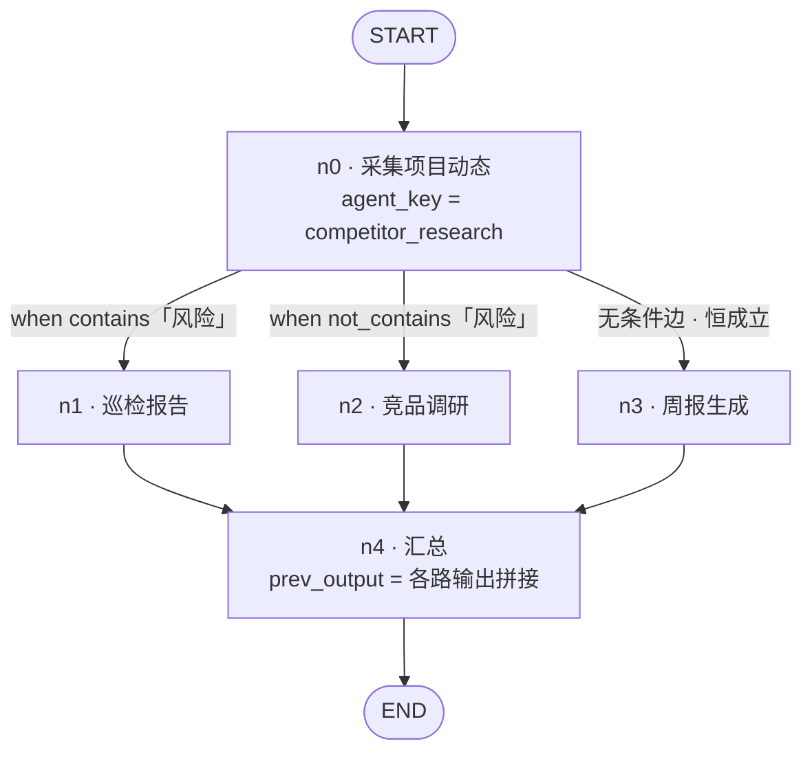

# VeyaWork 雅秩

> 面向小团队的 AI 原生工作台：把项目、任务、笔记收进同一个界面，让 **AI 副驾**、**多智能体**与**定时工作流**接手重复动作。

在线体验：<https://veyawork.work> —— 登录页点「**无需注册，直接体验**」即可进入预置样例数据的演示租户。

[](https://github.com/felixfeng-ai/ai-workflow-platform/actions/workflows/ci.yml)

---

## 这是什么

市面上的工具大多只解决一件事：Notion 管文档、Jira 管任务、Zapier 管自动化，而 AI 能力散落在各自的聊天窗口里。**雅秩把它们收进一个工作台，并让 AI 直接读写你的项目数据** —— AI 不是在旁边聊天，而是能读到「跨境选品」项目下有哪些任务逾期了，然后据此产出周报、发起工作流。

三个立足点：

|                             | 说明                                                                                              |
| --------------------------- | ------------------------------------------------------------------------------------------------- |
| **AI 是参与者，不是聊天框** | 智能体与工作流运行在真实业务数据上，产出直接落回项目（笔记 / 运行记录）                           |
| **自动化可编排、可定时**    | 多个智能体串成有序步骤，上一步的产出用 `{{prev_output}}` 注入下一步；支持 cron 与固定间隔调度     |
| **开箱可见，不留空壳**      | 未登录/后端不可达时自动进演示模式，访客入口一键进入带样例数据的租户 —— 拿给别人看不需要先教他注册 |

### 能力地图

- **工作台** —— 项目看板、任务看板（待办/进行中/已完成）、Markdown 笔记
- **代码提交分析** —— GitHub push Webhook 自动生成变更量、功能点、影响、安全扫描和测试缺口报告，支持搜索、筛选、分页和下载 DOCX
- **AI 副驾** —— SSE 流式对话，可挂载项目上下文，逐字返回
- **多智能体** —— 4 个内置智能体（周报 / 巡检报告 / 面试题 / 竞品调研）+ 自定义智能体（自写 Prompt、可挂工具）
- **工作流编排** —— 可视化画布连线编排，支持条件分支与并行执行，失败即止、可断点续跑、运行记录可回看
- **知识库 RAG** —— 上传 PDF / DOCX / Markdown，检索后问答并标注引用来源
- **AI 写作** —— 长文分段生成，产出统一走 Markdown 渲染
- **协作与通知** —— 多租户隔离、团队邀请与角色管理、站内通知中心、到期提醒（微信订阅消息）
- **5 套主题** —— 黑金旗舰 / 通透光感 / 深空蓝金 / 晶界金 / 墨韵（古风），可热切换并持久化

---

## 技术栈

| 层     | 选型                                                                                                  |
| ------ | ----------------------------------------------------------------------------------------------------- |
| 后端   | Python 3.12 · FastAPI · SQLAlchemy 2.0 (async) · Alembic · Pydantic v2 · APScheduler                  |
| 前端   | React 18 · TypeScript 5.6 · Vite 5 · Tailwind CSS 3.4 · React Flow (`@xyflow/react`) · react-markdown |
| 小程序 | Taro + React + TypeScript（微信端，订阅消息提醒）                                                     |
| 数据库 | PostgreSQL 16（生产） / SQLite（本地与单测）                                                          |
| AI     | 可插拔引擎：`dify`（Dify CE headless） 或 `openai_compatible`（DeepSeek / 通义等 OpenAI 协议端点）    |
| 交付   | Docker Compose · Nginx · GitHub Actions（CI + 自动部署）                                              |

---

## 快速开始

需要 **Python 3.12+** 与 **Node 20+**。以下命令已实测可跑通，默认走 SQLite，无需先装数据库。

### 后端

```bash
cd backend
python -m venv .venv
.venv/Scripts/activate          # Windows；macOS/Linux 用 source .venv/bin/activate
pip install -e ".[dev]"

# 建表：Alembic 是唯一的建表来源，代码里没有 create_all
alembic upgrade head

uvicorn app.main:app --reload --port 8000
```

接口文档：<http://localhost:8000/docs>（生产环境通过 nginx 隐藏）

### 前端

```bash
cd frontend
npm install
npm run dev                     # http://localhost:5173
```

前端启动后会探测后端 `/health`：**探通进 live 模式，探不通进演示模式**并显示红色横幅，横幅上的「重试连接」可在后端起来后就地重连，不需要刷新页面。

### 跑测试

```bash
cd backend
pytest -q                                   # 单元测试（内存 SQLite）
TEST_DATABASE_URL=postgresql+asyncpg://... pytest -q   # 集成测试（真实 PG，走 alembic 迁移）
```

---

## 项目结构

```
backend/                 FastAPI 服务
  app/api/               路由层：projects / tasks / notes / agents / workflows / ai / knowledge / ...
  app/services/          业务层：guest 访客租户、notification、scheduler、rag ...
  app/agents/            智能体：base + registry + 4 个内置实现 + custom 自定义
  app/workflows/         工作流执行器（LangGraph 图编排、条件分支、模板插值、运行记录）
  app/llm/               LangGraph 接缝（AiEngine→BaseChatModel 门面、SQLAlchemy Checkpointer）
  app/ai/                AI 引擎适配层（dify / openai_compatible 统一接口）
  alembic/               数据库迁移（建表的唯一来源）
  tests/                 26 个测试文件 / 319 个用例
frontend/                React SPA
  src/pages/             页面：Dashboard / Project / Agents / Workflows / Team / Login / Knowledge ...
  src/components/        组件：Shell / KanbanBoard / AiPanel / workflow 画布 ...
  src/lib/               api.ts（live）· demo.ts（演示）· mode.ts（模式探测）· theme.ts
miniapp/                 Taro 微信小程序端
nginx/                   网关配置（SPA + /api 反代、安全头、SSE 不缓冲）
deploy/hk-proxy/         香港反向代理上线脚本（见 DEPLOYMENT.md）
docs/                    平台介绍与技术方案、竞品分析
design-previews/         设计预览稿
```

---

## 架构要点

```
浏览器 ──► Nginx ──┬─► frontend (静态 SPA)
                   └─► backend (FastAPI)
                          ├─► PostgreSQL          业务数据，全部实体带 tenant_id
                          ├─► APScheduler         工作流定时调度（进程内单例）
                          └─► AI Engine           可插拔适配层
                                 ├─ Dify CE headless
                                 └─ OpenAI 兼容端点（DeepSeek / 通义）
```

### 架构图

#### ① 系统架构



#### ② 后端模块结构

```mermaid
flowchart LR
    subgraph API["路由层 · app/api/"]
        A1["projects · tasks · notes · docs"]
        A2["agents · workflows · ai · knowledge"]
        A3["auth · team · notifications · wechat"]
    end

    subgraph CAP["能力层"]
        C1["agents/ 智能体<br/>4 内置 + 自定义"]
        C2["workflows/ 工作流引擎<br/>graph · executor · scheduler"]
        C3["rag/ 知识库<br/>chunker · retriever"]
        C4["copilot/ AI 副驾"]
        C5["writing/ AI 写作"]
    end

    subgraph INF["基础设施层"]
        I1["llm/ LangGraph 接缝<br/>chat_model · checkpointer"]
        I2["ai/ 引擎适配<br/>dify · openai_compatible"]
        I3["services/<br/>guest · notification · deploy"]
        I4["core/<br/>security · ratelimit"]
    end

    subgraph DAT["数据层"]
        D1["models/ ORM"]
        D2["schemas/ 契约"]
        D3[("PostgreSQL / SQLite")]
    end

    API --> CAP
    API --> INF
    CAP --> INF
    INF --> DAT
```



#### ③ AI 能力栈：一个接口，两个实现



切换引擎是**部署级**的：`AI_PROVIDER` 环境变量在 `get_ai_engine()` 里二选一，没有前端入口、也没有按应用粒度的模型选择。

#### ④ 一次工作流执行流程



状态只在 `WorkflowState.outputs` 一个字段上流转，类型是 `Annotated[list[dict], operator.add]`：并行分支各写各的、由 reducer 合并，**节点之间不需要互相加锁**；每条结果带 `index`，收口时按 `index` 排序还原画布顺序——并行之下**完成顺序不等于步骤顺序**。`thread_id` 就是 `run_id`，续跑时 `ainvoke(None, ...)` 从最后一份检查点接着跑，已完成步骤不重跑。

#### ⑤ 工作流状态图：节点与条件边

图不是写死的 —— 画布上的 `steps`（节点）与 `edges`（边）在每次运行时编译成一张 `StateGraph`。下面是一个三路分支的示例：



四处与「按教程写的 LangGraph」不一样的地方：

- **节点名是 `n0`/`n1`…，不是画布上的 `node_id`** —— LangGraph 把节点名当通道名前缀（`branch:to:<name>`），带冒号或下划线的名字会被当成子图命名空间解析。`node_id` 是用户可提交的字符串，直接拿来当节点名等于把内部命名规则暴露给外部输入。
- **出边可以有多条同时成立** —— 路由器返回列表即**并行扇出**。互斥要靠条件自己写（如上面 `contains` / `not_contains` 成对）。无条件边恒成立。
- **一条边都不成立时抛错，不静默结束** —— 静默结束会把 run 记成 `succeeded`，用户看到「成功了但只跑了一半」，这是最难查的一类问题。
- **汇聚节点要求各分支等深** —— 不等深的汇聚在**保存时**就被 `validate_graph` 判为非法，而不是运行时悄悄多烧一次模型调用。

条件本身是一门结构化 DSL，不是表达式字符串（避免把服务端任意代码执行权交出去）：

```json
{ "op": "contains", "left": "{{prev_output}}", "right": "风险" }
```

`op` 是一份白名单：文本（`contains` / `not_contains` / `starts_with` / `ends_with`）、相等（`eq` / `ne`）、空值（`is_empty` / `not_empty`）、数值（`gt` / `gte` / `lt` / `lte`）、组合（`all` / `any` / `not`，最多嵌套 6 层）。没有属性访问、没有函数调用、没有下标。

---

几条贯穿全局的设计约束，改代码时请留意：

1. **多租户行级隔离** —— 每个实体都带 `tenant_id`，所有查询必须按租户过滤。跨租户访问与资源不存在**一律返回 404**，避免泄漏「这个 id 是否存在」。
2. **Alembic 是唯一建表来源** —— 不要在应用代码里加 `create_all`。
3. **后台任务自开会话** —— 智能体与工作流执行器各自持有独立 session，绝不共享请求级会话。
4. **调度器是全进程单例** —— 多 worker 部署前必须换成分布式锁，否则同一任务会被重复触发。
5. **AI 产出统一走 Markdown 渲染** —— 前端只有一个渲染入口（`<Markdown>`），新增展示位不要再手写 `whitespace-pre-wrap`。

---

## 部署

生产为 Docker Compose（PostgreSQL + 后端 + 前端 + Nginx 网关），推送到 `main` 后由 GitHub Actions 触发服务器脚本自动部署。纯文档改动（`**.md` / `docs/**` / `design-previews/**`）不会触发重建。

访问链路：`veyawork.work` → 香港反代 → 阿里云 8080。香港侧需把 `Host` 头改写成上游 `IP:8080`（真实域名经 `X-Forwarded-Host` 传递）以规避阿里云按 Host 的 ICP 拦截。

完整步骤、环境变量清单与排障见 **[DEPLOYMENT.md](DEPLOYMENT.md)**，配置模板见 [`.env.example`](.env.example)。

---

## 文档索引

| 文档                                                                           | 内容                                                                                         |
| ------------------------------------------------------------------------------ | -------------------------------------------------------------------------------------------- |
| [docs/platform-overview.md](docs/platform-overview.md)                         | **平台全景**：定位、能力地图、技术选型理由、9 个核心技术方案、数据模型、路线图、对外介绍话术 |
| [docs/code-analysis-technical-design.md](docs/code-analysis-technical-design.md) | **代码提交分析**：GitHub 接入、数据模型、Webhook、分析流水线、报告结构与实施阶段 |
| [DEPLOYMENT.md](DEPLOYMENT.md)                                                 | 部署与运维：环境变量、Docker Compose、香港反代、排障                                         |
| [DESIGN.md](DESIGN.md)                                                         | 设计体系：色彩、排版、组件规范                                                               |
| [docs/competitive-analysis.md](docs/competitive-analysis.md)                   | 竞品分析                                                                                     |
| [research/AI_WORKFLOW_PLATFORM_PLAN.md](research/AI_WORKFLOW_PLATFORM_PLAN.md) | 立项规划                                                                                     |

---

## 工程状态

- 后端 117 个文件 / 8,562 行，前端 50 个文件 / 8,651 行
- 26 个测试文件 / 319 个用例，CI 双跑：内存 SQLite 单测 + 真实 PostgreSQL 集成测试（走迁移）
- CI 每次推送跑后端测试与前端构建；`main` 分支自动部署生产
